A reference and archive page documenting hardware tools and PCB revisions used for Voltage, Clock and Electromagnetic Fault Injection (glitching). Hextree target boards and misc tools are in the collapsible lists under the Faultier table, and you can also jump to them from the table of contents.

## Hextree - Glitching Hardware (Faultier)

The Hextree Faultier is an inexpensive voltage fault-injection tool and the companion hardware for Hextree's fault-injection courses. It uses an N-channel MOSFET for crowbar glitching and a 2-channel analogue switch for dipping the supply voltage or power-cycling a target, and it can also trigger external tools such as the NewAE ChipSHOUTER®.

A built-in SWD probe lets you dump glitched chips and check whether a glitch worked after a debug feature is re-enabled, as in the nRF52 APPROTECT bypass or the STM32 RDP2-to-1 downgrade. Faultier can also take basic voltage measurements, for example to time a glitch on an nRF52, and is controlled through the `faultier` Python package.

Features:

- Raspberry Pi Pico / RP2040 based
- 200 MHz (5 ns) glitch resolution
- Integrated SWD probe
- N-channel MOSFET (DMG2302UK)
- 2-channel analogue switch
- Python control library

**Source:** [1BitSquared](https://1bitsquared.com/products/faultier)  
**GitHub:** [github.com/hextreeio/faultier](https://github.com/hextreeio/faultier)

| Revision / Model | Image & Photo Credit | Notes & Identification |
| :--- | :---: | :--- |
| **Faultier v01 (Proto)** | 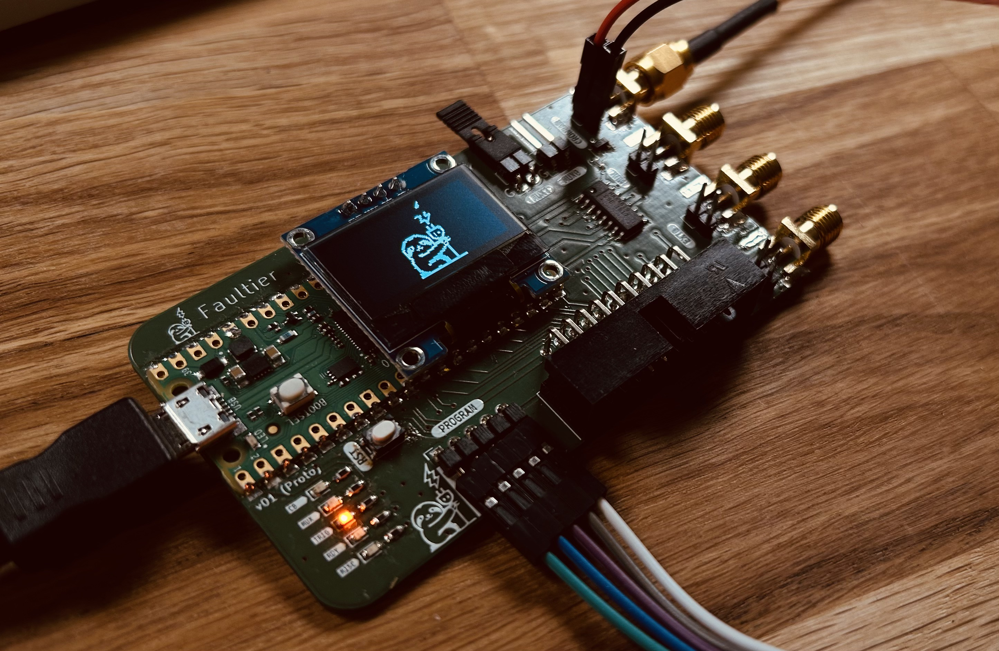 <small>Source: [Hextree.io](https://x.com/hextreeio/status/1803505950533492963)</small> | **Display:** OLED **Analog switch:** SOIC-16 MAX4619 **Rear:** No Public Info |
| **Faultier v02** | 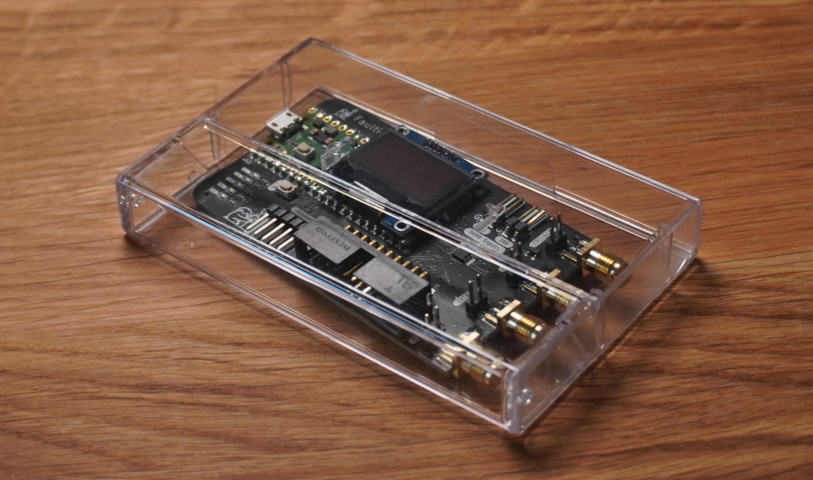 <small>Source: [Hextree.io](https://x.com/hextreeio/status/1808491848618377576)</small> | **Display:** OLED **Analog switch:** MSOP-10, marking "JEx" (possibly a TS-series part) **Changes from v01:** PCB design (black PCB, minor layout changes), different analog switch **Rear:** No Public Info |
| **Faultier v3** | 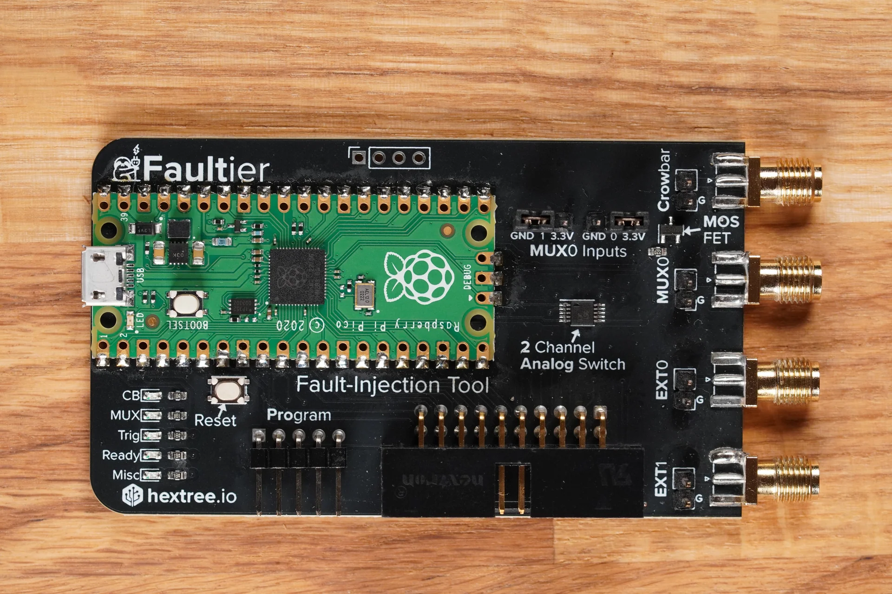 <small>Source: [1BitSquared](https://1bitsquared.com/products/faultier)</small> | **Unconfirmed: believed to be v3** **Analog switch:** Same as v02 **Changes from v02:** OLED removed (can be soldered), minor PCB design changes |
| **Faultier v4** | 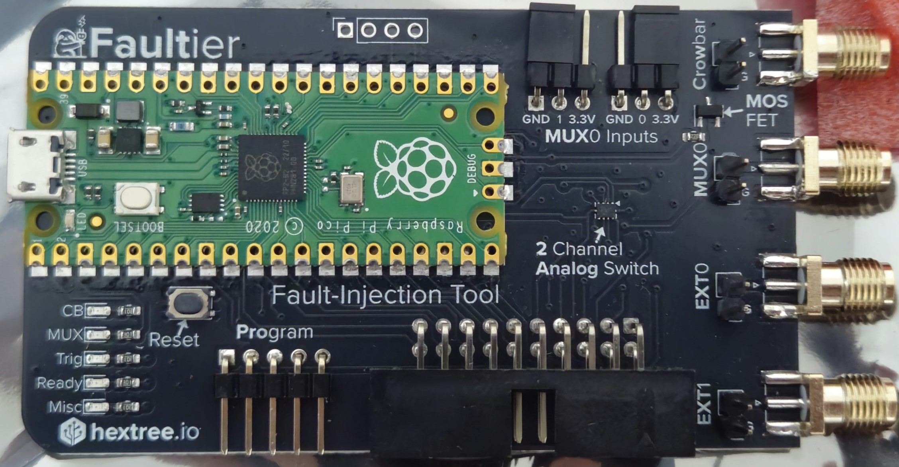 <small>Source: [heapcat](https://heapcat.github.io/)</small> | **Analog switch:** UQFN-10 TS5A23159 **Changes from v3:** Different analog switch, minor PCB design changes |

### Hextree - Target Boards

Show target boards

Companion target boards created by Thomas Roth ([stacksmashing](https://github.com/stacksmashing)) / [Hextree.io](https://www.hextree.io/) for practicing hardware attacks. This section covers the target boards and their revisions as they are documented.

| Revision / Model | Image & Photo Credit | Notes & Identification |
| :--- | :---: | :--- |
| **GlitchTag (Early)** | 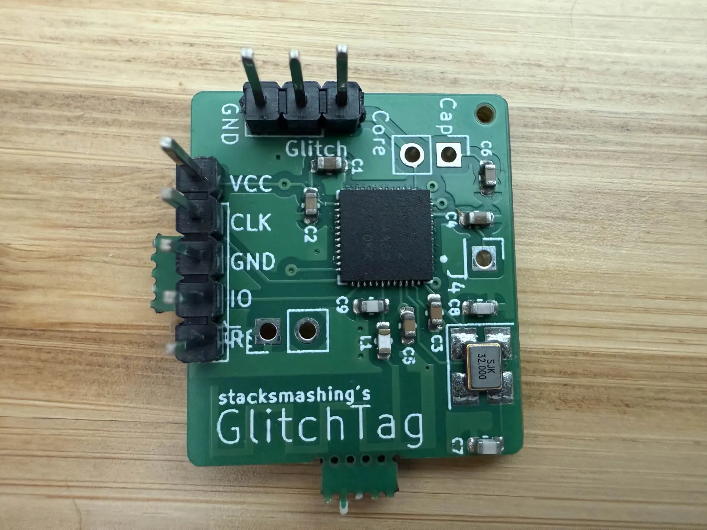 <small>Source: [@maxreality](https://discord.com/channels/988720305524588626/1274712786609639496/1342956011841130546)</small> | AirTag-inspired **nRF52832** target. **Branding:** "stacksmashing's GlitchTag" **Rear:** TBD |
| **GlitchTag (Latest)** | 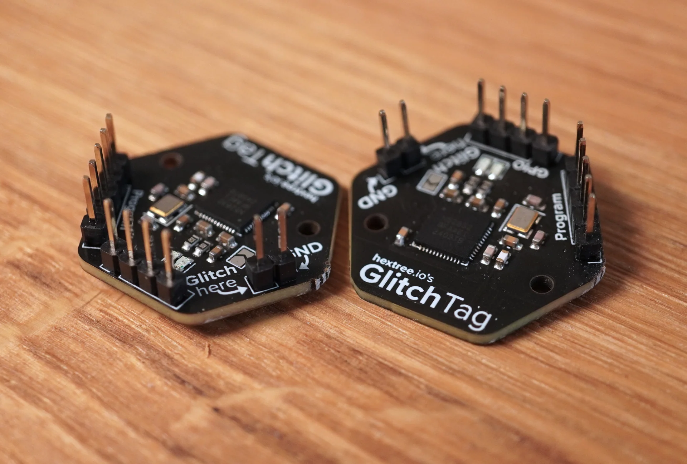 <small>Source: [1BitSquared](https://1bitsquared.com/products/glitch-tag)</small> | Latest Hextree production revision. Sold in packs of two, alone or with Faultier. |
| **Damn Glitchable Wallet (Black)** | 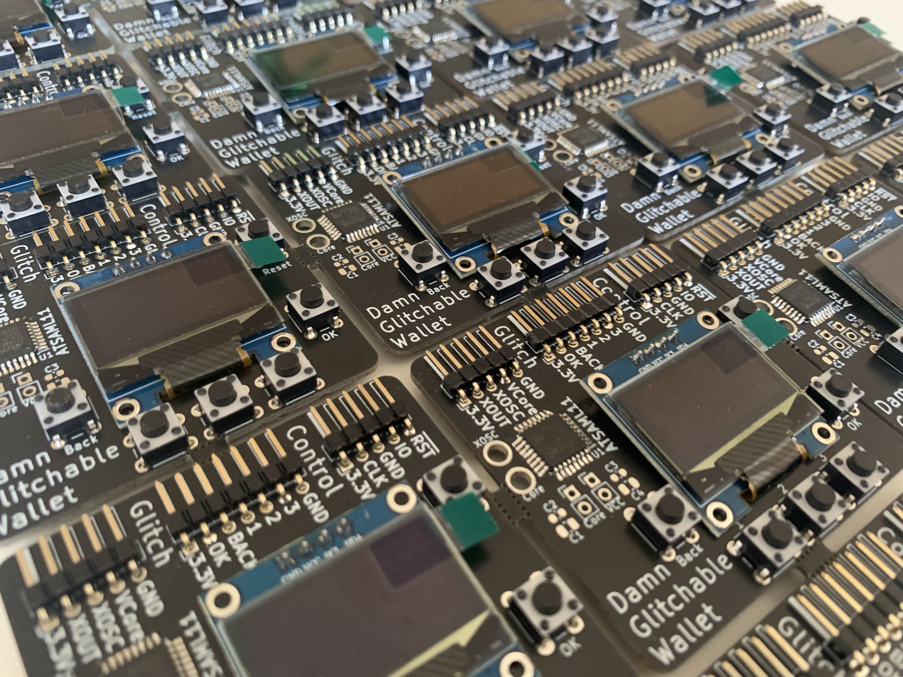 <small>Source: [@hextreeio](https://x.com/hextreeio/status/1662425852565487616/photo/1)</small> | Black version, first posted in 2023. No further public information. **MCU:** ATSAML11 |
| **Damn Glitchable Wallet (Hextrezor)** | 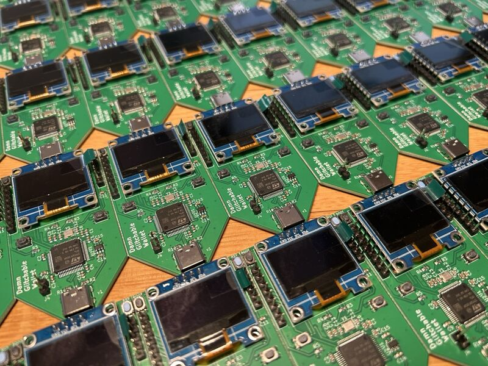 <small>Source: [Thomas Roth (Stacksmashing)](https://www.linkedin.com/posts/stacksmashing_our-hextreeio-applied-fault-injection-training-share-7485300929421000704-7dKt/)</small> | Green version, named "Hextrezor" by LiveOverflow in his DEF CON blog. **MCU:** STM32 (exact part TBD) |
| **RP2350 Security Playground** | 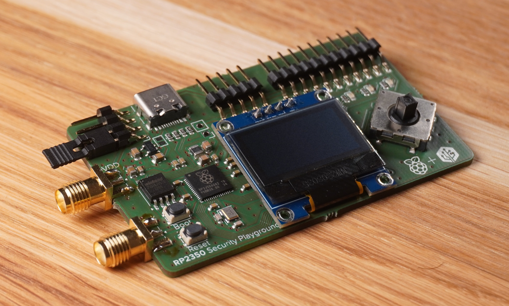 <small>Source: [@hextreeio](https://x.com/hextreeio/status/1822051289423049006)</small> | Target board made by Hextree with Raspberry Pi for the RP2350 hacking challenge. Handed out at DEF CON 32 (2024). [Hextree.io](https://www.hextree.io/rp2350) · [Raspberry Pi announcement](https://www.raspberrypi.com/news/can-you-hack-our-new-chip/) · [Challenge results](https://www.raspberrypi.com/news/security-through-transparency-rp2350-hacking-challenge-results-are-in/) · [Firmware](https://github.com/hextreeio/rp2350-security-playground-demo) |
| **STM32 target (2026)** | 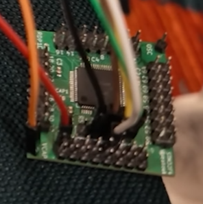 <small>Source: [LiveOverflow](https://www.youtube.com/watch?v=kJzjUpbjeyM)</small> | STM32 glitching target used alongside GlitchTags to teach fault injection. Used at Black Hat 2026 and, probably, DEF CON. Shown in the LiveOverflow vlog "Two Weeks of Black Hat & DEF CON" (Sep 2026). **MCU:** STM32 (exact part unknown) |

### Hextree - Misc

Show misc hardware

Other hardware by Thomas Roth [(Stacksmashing)](https://github.com/stacksmashing) / [Hextree.io](https://www.hextree.io/) that isn't a Faultier or a glitching target, such as tools, course hardware, event giveaways and challenge badges.

| Revision / Model | Image & Photo Credit | Notes & Identification |
| :--- | :---: | :--- |
| **Micro-soldering challenge tag** |  <small>Source: [@hextreeio](https://x.com/hextreeio/status/1819008683483001142)</small> | Beginner micro-soldering challenge tag from Hextree at DEF CON. Solder LEDs (0805 to 0402) and check them by holding the tag against a phone. |
| **Unknown stacksmashing/Hextree tool** | 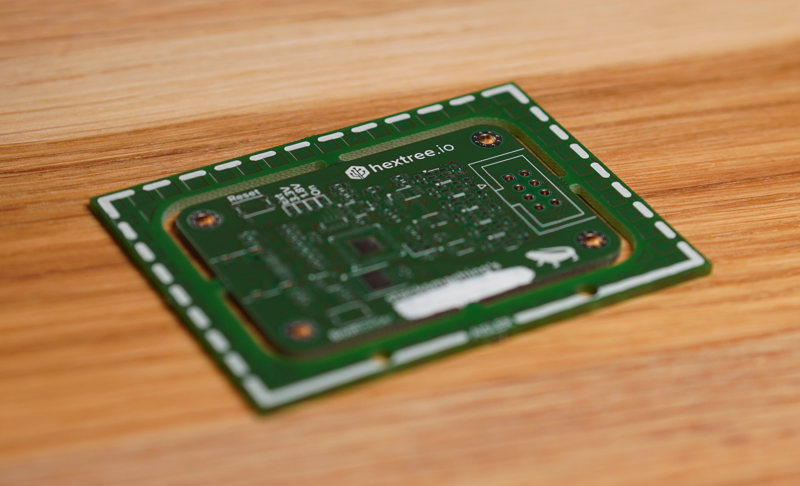 <small>Source: [Thomas Roth (Stacksmashing)](https://www.linkedin.com/posts/stacksmashing_new-pcb-day-i-finally-got-around-to-share-7268300165747290114-BZnZ/)</small> | Prototype tool marked "hextree.io", shown in a stacksmashing "New PCB day" post. Purpose not disclosed. **Rear:** No Public Info |
| **Router/IoT hacking course router** | 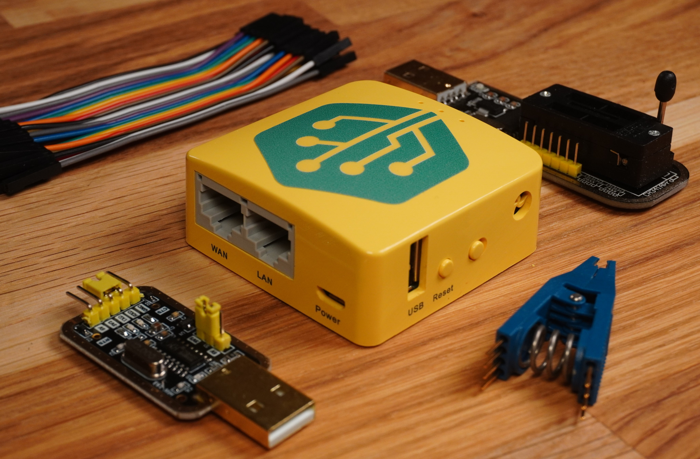 <small>Source: [@hextreeio](https://x.com/hextreeio/status/1861112988377153688/)</small> | Router for Hextree's router/IoT hacking course, shown in around November 2024 while the course was in development. Runs a customized bootloader and router OS. |
| **Pico TPM Sniffer** | 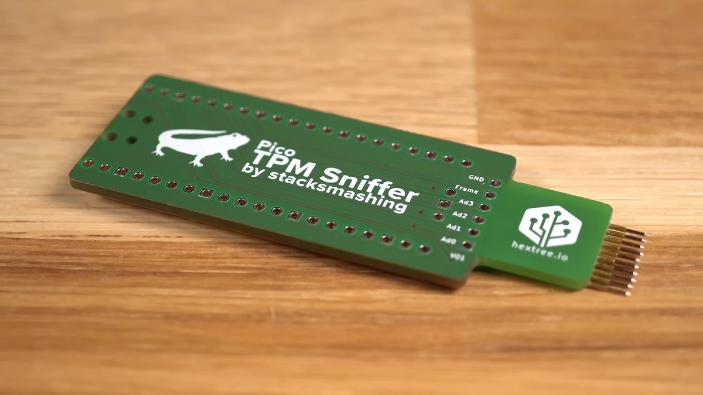 <small>Source: [@tomshardware](https://x.com/tomshardware/status/1755050528654991553)</small> | Experimental LPC bus TPM sniffer by stacksmashing, built around a Raspberry Pi Pico. Compatible with the Debug Card connector on some Lenovo laptops. LPC only (no SPI TPMs). [GitHub](https://github.com/stacksmashing/pico-tpmsniffer) |

## Thomas Roth (stacksmashing) - PDnD

The following project is related through its author, Thomas Roth ([stacksmashing](https://github.com/stacksmashing)), but is documented separately because it is not identified as official Hextree hardware.

- **[Pico Debug’n’Dump (PDnD)](https://pdnd.stacksmashing.net/)** - a Raspberry Pi Pico-based debugging and glitching board.

| Revision / Model | Image & Photo Credit | Notes & Identification |
| :--- | :---: | :--- |
| **Pico Debug’n’Dump (PDnD)** | 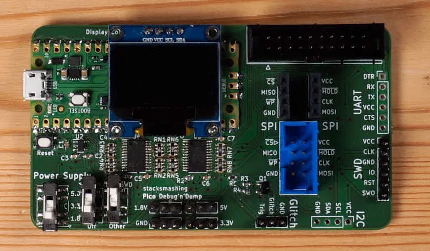 <small>Source: [Thomas Roth (Stacksmashing)](https://www.tomshardware.com/news/raspberry-pi-pico-deump-and-debug-board-kit)</small> | Raspberry Pi Pico / RP2040-based multipurpose debugging board with level-shifted I/O, selectable target voltage levels, SPI flash programming, UART, I2C/SWD and basic voltage-glitching capabilities.  **Date:** Circa mid-2021; publicly documented by 8 July 2021. |

## Matthias Kesenheimer - PicoGlitcher

Created by Matthias Kesenheimer. Open-source voltage fault injection hardware built around the Raspberry Pi Pico (v3.0 uses the Pico 2), with a Python library called `findus`.

**Docs:** [fault-injection-library.readthedocs.io](https://fault-injection-library.readthedocs.io/)  
**Changelog and hardware versions:** [fault-injection-library.readthedocs.io/en/latest/versions](https://fault-injection-library.readthedocs.io/en/latest/versions/)  
**GitHub:** [github.com/MKesenheimer/fault-injection-library](https://github.com/MKesenheimer/fault-injection-library)  
**Project logs:** [hackaday.io/project/196357](https://hackaday.io/project/196357/logs)

| Revision / Model | Image & Photo Credit | Notes & Identification |
| :--- | :---: | :--- |
| **Pico Glitcher v1.0** | 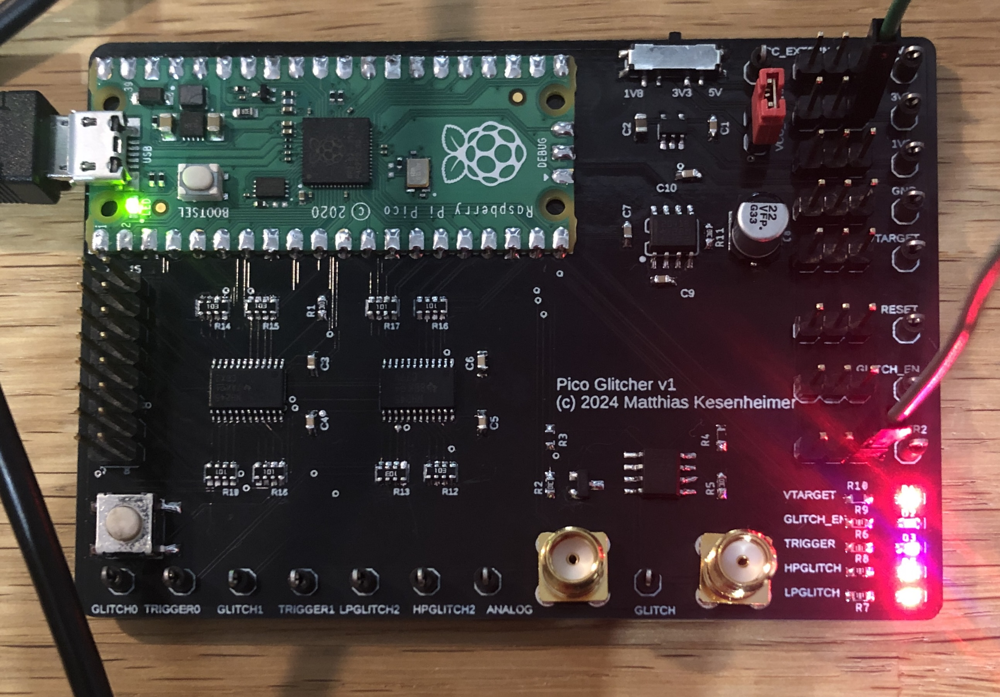 <small>Source: [Matthias Kesenheimer](https://mkesenheimer.github.io/blog/pico-glitcher-pcb.html)</small> | First prototype: Raspberry Pi Pico, two power MOSFETs, level shifters, switchable power supply. Probably the July 2024 first build with black PCB (Hackaday). |
| **Pico Glitcher v1.1** | 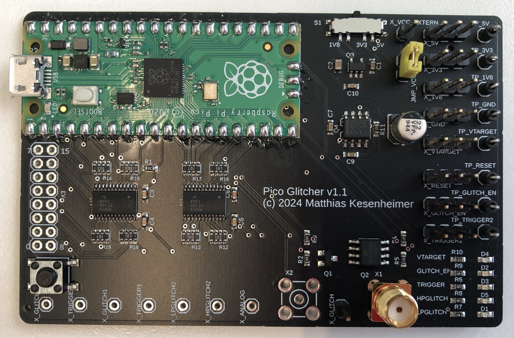 <small>Source: [Matthias Kesenheimer](https://x.com/BartimaeusvUruk/status/1844771924229923014)</small> | Public release of v1. MOSFETs: IRLML2502 (low power) and SI4134DY (high power). First batch of v1 sold out Dec 2024 (Hackaday). **Changes from v1.0:** Layout changed, LED issue fixed (a Sept 2024 log also mentions clearer PCB markings, probably this revision) |
| **Pico Glitcher v2.0 (modified with Pico 2)** | 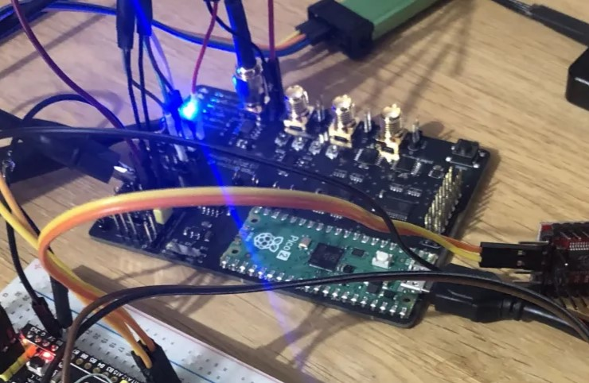 <small>Source: [@dr_j.zoidberg](https://discord.com/channels/1338062169433968642/1338064292917809172/1480094923092000869)</small> | **Unconfirmed: believed to be v2.0.** First v2 prototype. First voltage multiplexer (GND, 1.8 V, 3.3 V, arbitrary VIN input), which didn't work properly without extra pull-up resistors. Probably never sold publicly. **Changes from v1.1:** Multiplexer added, GPIO header pin assignment changed, smaller capacitor on VTARGET **Note:** The 16-pin GPIO header fits v2.0 (also true for v1.x). The RESET button is large, as on v1.1 and v2.1 (v2.2 and later use a small one), but it sits in a different position, at the lower-left edge. The via layout is unlike any other documented revision. The marking appears to read "PicoGlitcher v2" and "(c) 2024". |
| **Pico Glitcher v2.1** | 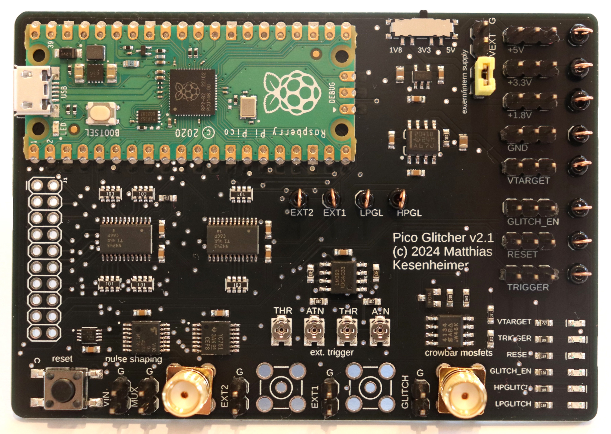 <small>Source: [Matthias Kesenheimer](https://x.com/BartimaeusvUruk/status/1887242573682487795/)</small> | Public release of v2. Schmitt trigger inputs EXT1/EXT2 (a v2 feature). VTARGET power switch (TPS2041) only switches voltages above 2.2 V. **Changes from v2.0:** Multiplexer fixed, GPIO header 16 to 20 pins, level shifters removed on GPIO16-19 (for the pulse shaping board) |
| **Pico Glitcher v2.2** | 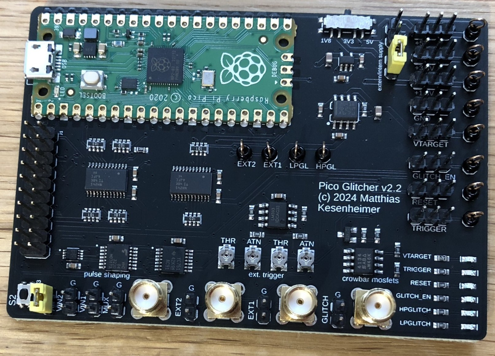 <small>Source: [Matthias Kesenheimer](https://x.com/BartimaeusvUruk/status/1903473838467244138)</small> | **Changes from v2.1:** Better layout (thicker power tracks), multiplexer now has two arbitrary voltage inputs (VIN1, VIN2) with a jumper to fix VIN2 at 3.3 V |
| **Pico Glitcher v2.3** | *No photo yet* | Problem version: red power LED didn't light properly, and the level shifters only worked with 3.3 V logic. **Changes from v2.2:** Power switch TPS2041 to TPS22860 (faster, switches lower voltages), level shifters NH245 to TXB0108, VTARGET capacitors removed |
| **Pico Glitcher v2.4** | 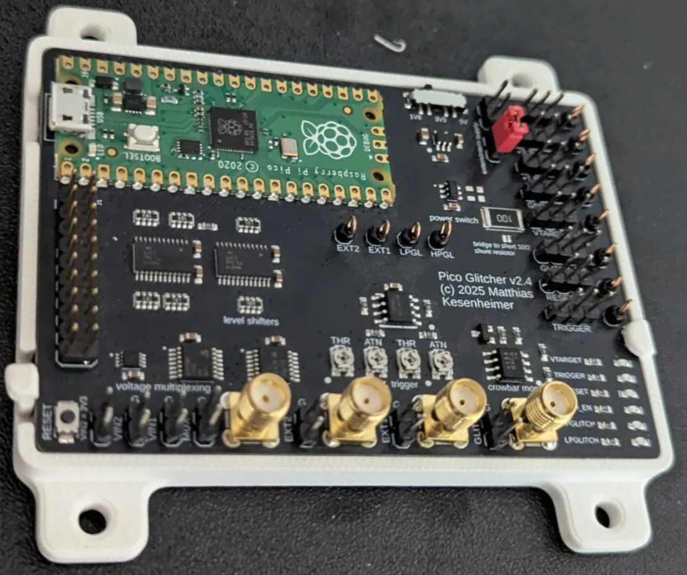 <small>Source: [@miketangoromeo](https://discord.com/channels/1338062169433968642/1338062170419757120/1532299107417325568)</small> | **Changes from v2.3:** Better layout, back to NH245 level shifters, 10 Ω resistor on VTARGET to protect the power switch (bypass with a solder bridge) |
| **Pico Glitcher v3.0** | 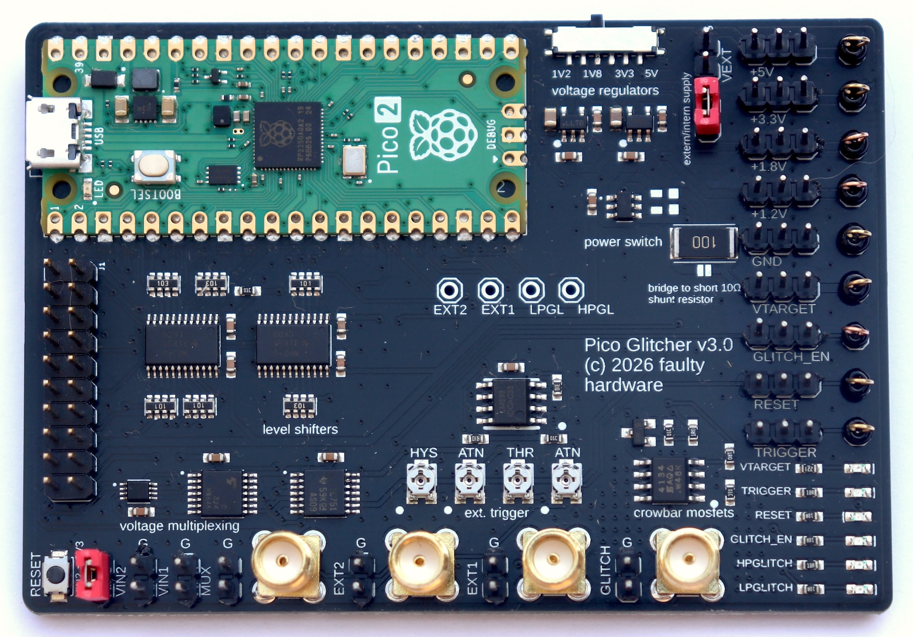 <small>Source: [Matthias Kesenheimer](https://x.com/BartimaeusvUruk/status/2015148753670279659/)</small> | Based on Raspberry Pi Pico 2. Selectable 1.2 V / 1.8 V / 3.3 V / 5 V supply. **Changes from v2.4:** Pico 2, new voltage options, improved Schmitt triggers, tented vias and more vias in critical regions |

## NewAE

Created by Colin O'Flynn / [NewAE Technology](https://www.newae.com/chipwhisperer). FPGA and MCU-based toolchain for Side-Channel Power Analysis (SPA/CPA) and Fault Injection.

**Docs:** [chipwhisperer.readthedocs.io](https://chipwhisperer.readthedocs.io/)  
**GitHub:** [github.com/newaetech/chipwhisperer](https://github.com/newaetech/chipwhisperer)

| Revision / Model | Image & Photo Credit | Notes & Identification |
| :--- | :---: | :--- |
| **ChipWhisperer®-Nano (CW1101)** | 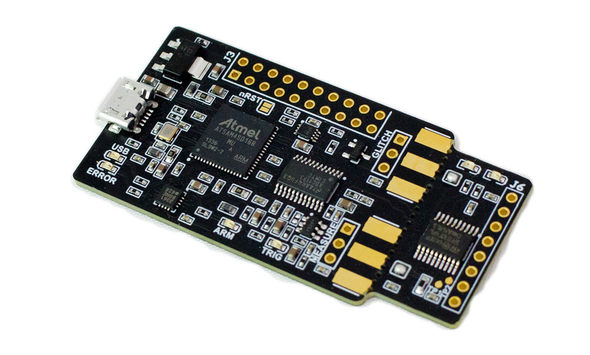 <small>Source: [NewAE](https://chipwhisperer.readthedocs.io/en/latest/Starter%20Kits/ChipWhisperer-Nano.html)</small> | |
| **ChipWhisperer®-Lite (CW1173)** | 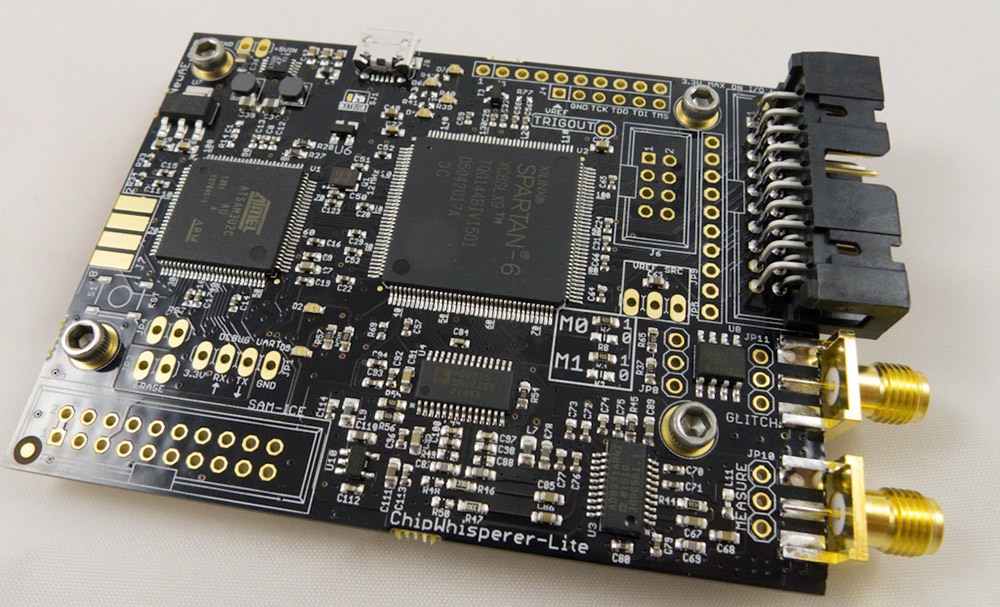 <small>Source: [NewAE](https://chipwhisperer.readthedocs.io/en/latest/Starter%20Kits/ChipWhisperer-Lite.html)</small> | |
| **ChipWhisperer®-Pro (CW1200)** | 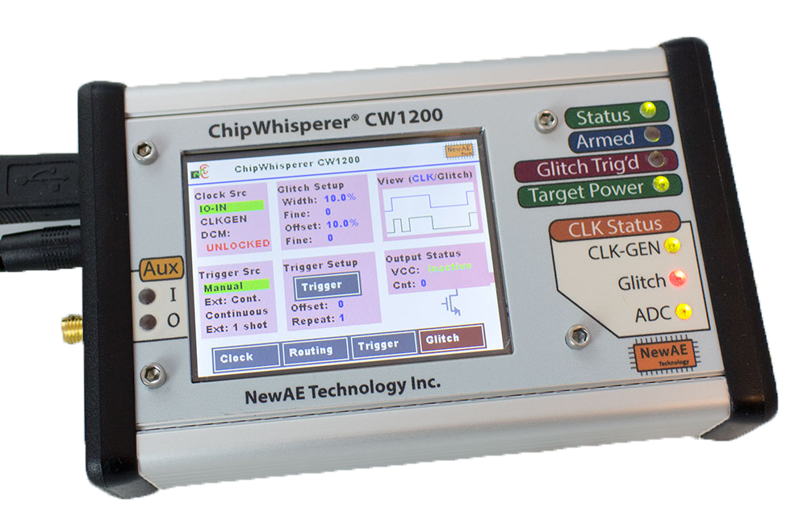 <small>Source: [NewAE](https://chipwhisperer.readthedocs.io/en/latest/Starter%20Kits/ChipWhisperer-Pro.html)</small> | |
| **ChipWhisperer®-Husky** | 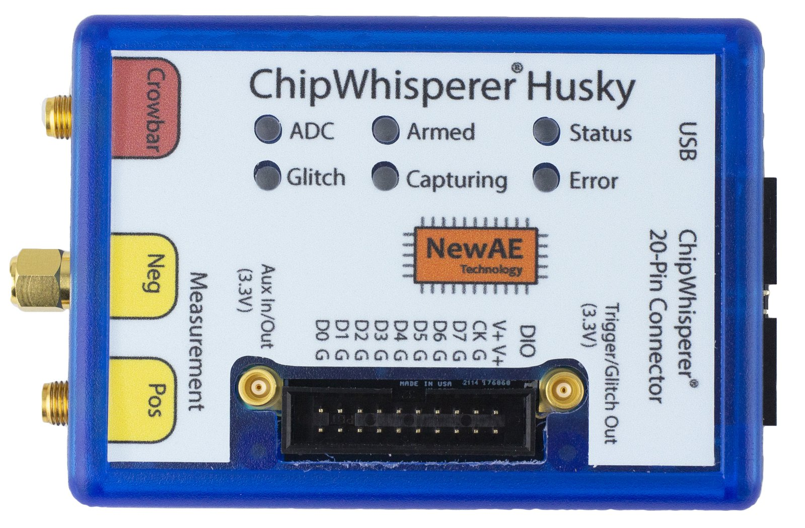 <small>Source: [NewAE](https://chipwhisperer.readthedocs.io/en/latest/Capture/ChipWhisperer-Husky.html)</small> | |
| **ChipWhisperer®-Husky-Plus** | 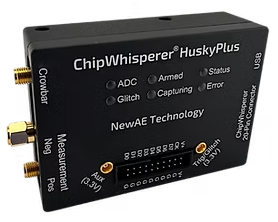 <small>Source: [NewAE](https://www.newae.com/chipwhisperer)</small> | Husky with larger buffers, a faster ADC and longer trigger sequences. |
| **ChipWhisperer®-Husky Pro Joe Grand Edition** | 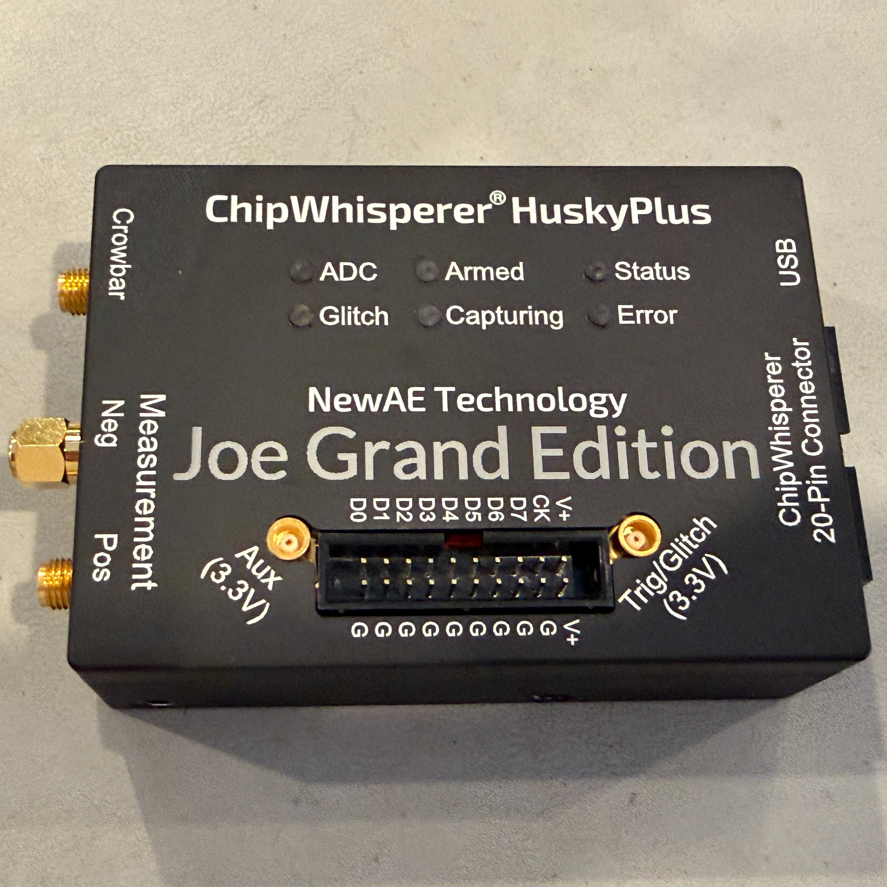 <small>Source: [@joegrandofficial](https://www.instagram.com/p/DaGFm2-m8DQ/)</small> | |
| **ChipSHOUTER® (CW520)** | 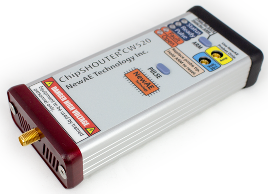 <small>Source: [NewAE](https://chipwhisperer.readthedocs.io/en/latest/ChipSHOUTER/ChipSHOUTER.html)</small> | |
| **ChipSHOUTER®-PicoEMP** | 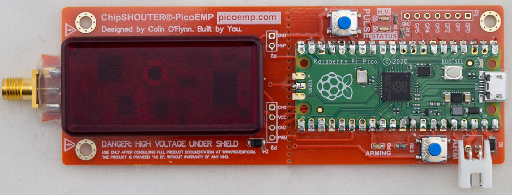 <small>Source: [NewAE](https://github.com/newaetech/chipshouter-picoemp)</small> | |
| **ChipJabber®-Unplugged** | 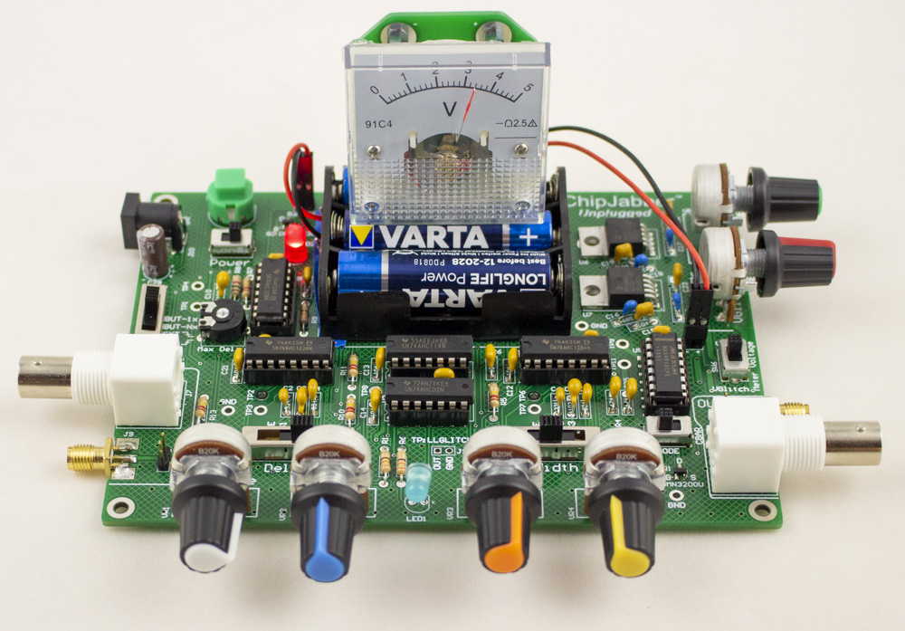 <small>Source: [NewAE](https://chipjabber-unplugged.com/)</small> | DIY voltage fault-injection tool using predominantly through-hole components. Can be assembled on a breadboard or perfboard using the provided schematic. Designed for learning and experimenting with voltage glitching without programmable logic. |
| **ChipJabber®-Unplugged Mini** | 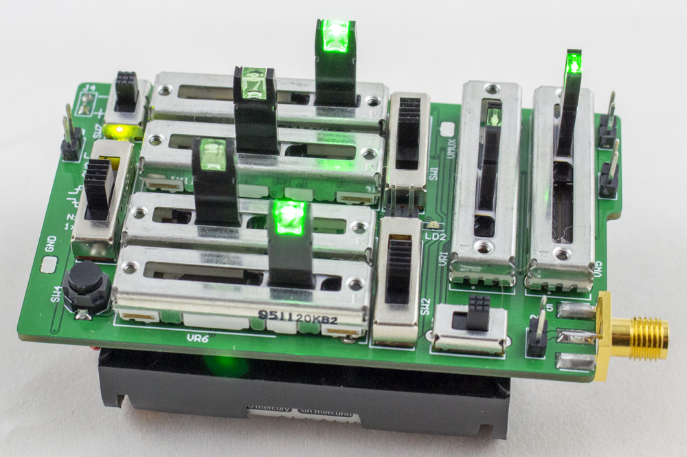 <small>Source: [NewAE](https://chipjabber-unplugged.com/)</small> | Compact, pre-built version using surface-mount components. Features large slider-style potentiometers for manually adjusting glitch parameters. |
| **ChipJabber®-Unplugged Home-Etch PCB** | 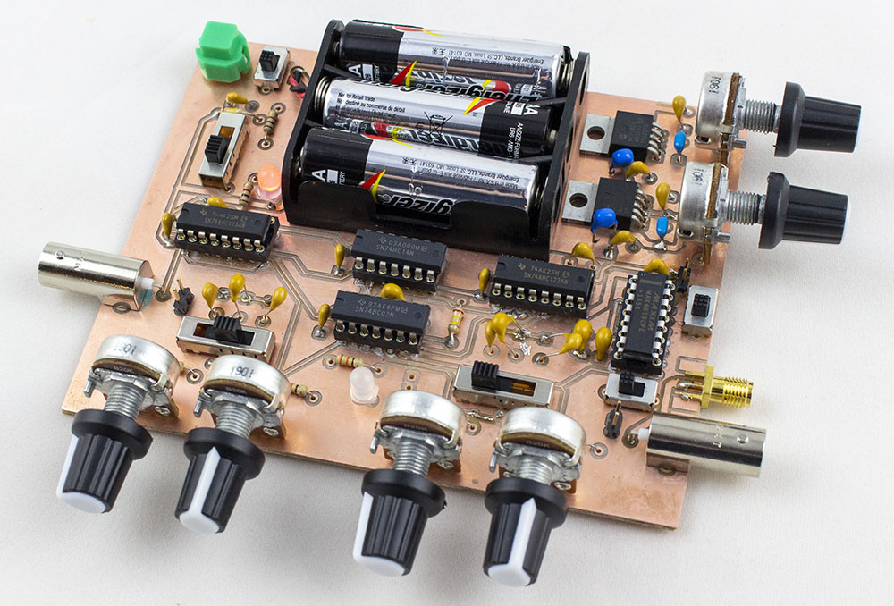 <small>Source: [NewAE](https://chipjabber-unplugged.com/)</small> | Simplified, double-sided PCB design intended for home etching or PCB milling. Minimizes the number of vias. |

## Positive Technologies - Chip'olino

Chip'olino is a hardware-software platform designed for performing glitch attacks via power supply. It includes the main Chip'olino board and a set of addons for various microcontrollers. It addresses two main tasks: performing known power supply attacks on microcontrollers, and research and experiments in the field of power supply attacks.

**GitHub:** [github.com/y0v1737/chipolino](https://github.com/y0v1737/chipolino)

| Revision / Model | Image & Photo Credit | Notes & Identification |
| :--- | :---: | :--- |
| **Chip'olino Rev. A** | 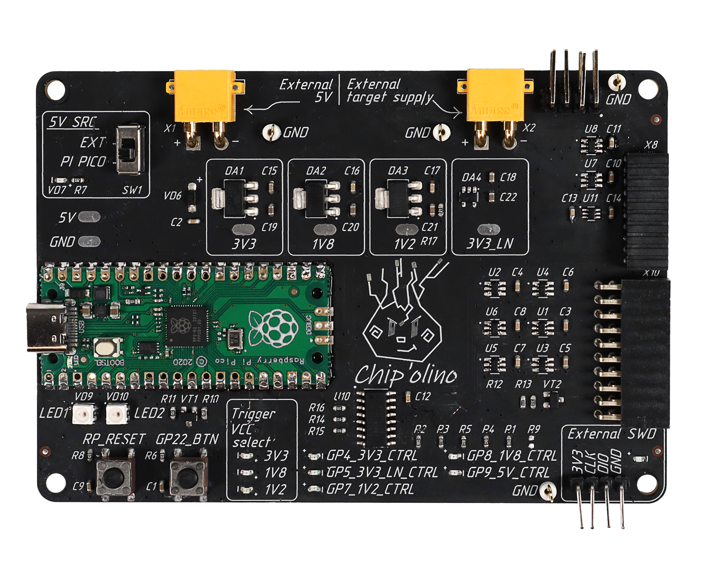 <small>Source: [@y0v1737](https://github.com/y0v1737/chipolino/blob/main/The_Playbook/pics/pcb_pics/Chip%27olino.png)</small> | |

## IOActive - Glitch.IO

**IOActive Glitcher v0.2 (Glitch.IO)** is an in-house, Raspberry Pi Pico-based hardware fault-injection tool developed by IOActive to evaluate microcontroller security. It injects precisely timed voltage glitches to disrupt CPU execution and assess the effectiveness of hardware countermeasures, including the glitch detectors in the Raspberry Pi Pico 2's RP2350 microcontroller. Its modular SDK supports different glitching techniques, trigger mechanisms, communication protocols, and target-specific security tests.

**Source:** [IOActive](https://www.ioactive.com/characterizing-the-raspberry-pico-2-fi-countermeasures-part-1/)

| Revision / Model | Image & Photo Credit | Notes & Identification |
| :--- | :---: | :--- |
| **Glitcher V0.2 (Glitch.IO)** | 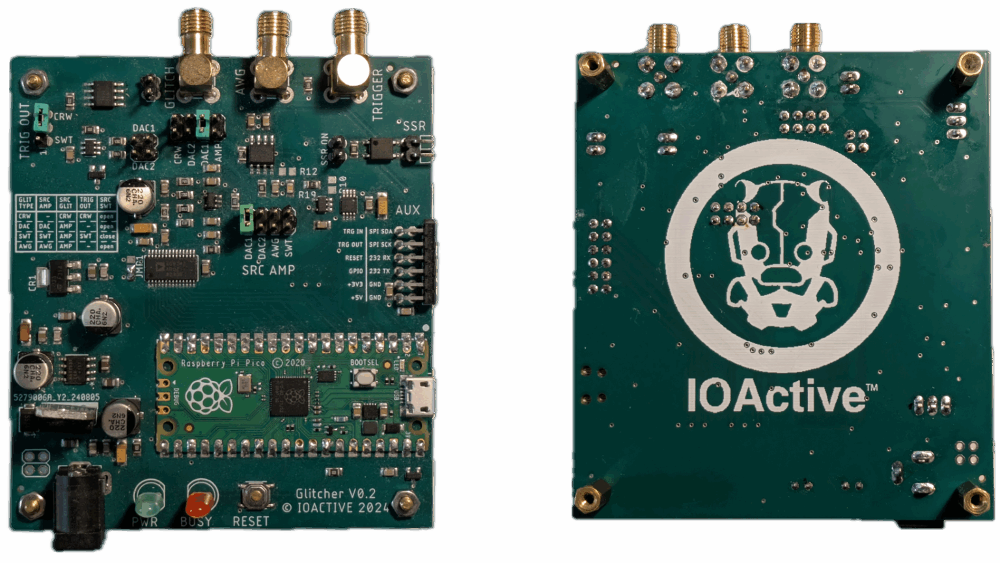 <small>Source: [IOActive](https://www.ioactive.com/characterizing-the-raspberry-pico-2-fi-countermeasures-part-1/)</small> | |

## Dhiru Kholia - SimpleGlitcher

SimpleGlitcher is a small RP2350 / Raspberry Pi Pico 2 based board for simple 3.3 V voltage glitching experiments.

**GitHub:** [github.com/kholia/SimpleGlitcher](https://github.com/kholia/SimpleGlitcher)  
**Dhiru's Notebook:** [rfcorner.in/posts/voltage-glitching-for-fun-and-profit/](https://rfcorner.in/posts/voltage-glitching-for-fun-and-profit/)

| Revision / Model | Image & Photo Credit | Notes & Identification |
| :--- | :---: | :--- |
| **SimpleGlitcher (Aug. 2026)** | 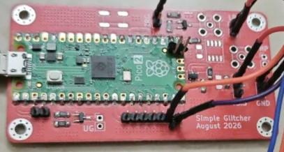 <small>Source: [@dhiru.kholia](https://discord.com/channels/1338062169433968642/1338062170419757120/1532611891745001482)</small> | SimpleGlitcher with "August 2026" tag, first publicly seen on the "Faulty Hardware" Discord server on July 31st 2026. |
| **SimpleGlitcher (Nov. 2026, render)** | 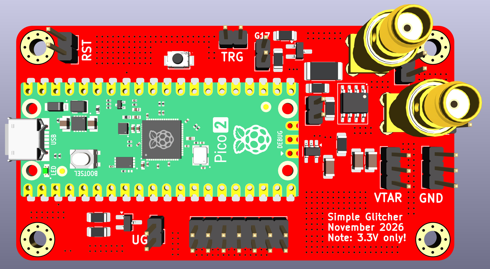 <small>Source: [@dhiru.kholia](https://github.com/kholia/SimpleGlitcher)</small> | SimpleGlitcher 3D render with "November 2026" tag, from Dhiru's GitHub repo, dated August 5th 2026. |

## Curious Supplies - Curious Bolt

Curious Bolt is a hardware hacking multi-tool designed by Joris Witteman for Curious Supplies (Tom Clement). It combines a programmable crowbar voltage glitcher, an 8-channel logic analyzer, programmable I/O and a differential power oscilloscope in a single board.

**Documentation:** [bolt.curious.supplies/docs](https://bolt.curious.supplies/docs/)  
**GitHub:** [tjclement/bolt](https://github.com/tjclement/bolt)  
**Product page:** [Curious Bolt](https://bolt.curious.supplies/)

| Revision / Model | Image & Photo Credit | Notes & Identification |
| :--- | :---: | :--- |
| **Curious Bolt** | 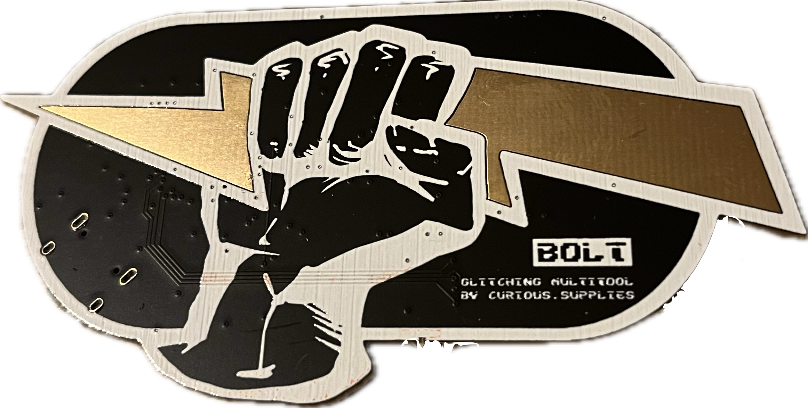 <small>Source: [tjclement/bolt](https://github.com/tjclement/bolt)</small> | **PCB artwork:** ankhaneko.art |

## ElectronicCats - FaultyCat

FaultyCat is an electromagnetic fault injection (EMFI) tool by Electronic Cats, based on a remix of the ChipSHOUTER PicoEMP design. Its design priorities, in order, are safe operation, high performance, usability and cost, so it covers many use cases but may be more than some users need.

**GitHub:** [ElectronicCats/faultycat](https://github.com/ElectronicCats/faultycat)

| Revision / Model | Image & Photo Credit | Notes & Identification |
| :--- | :---: | :--- |
| **FaultyCat v1.1** | 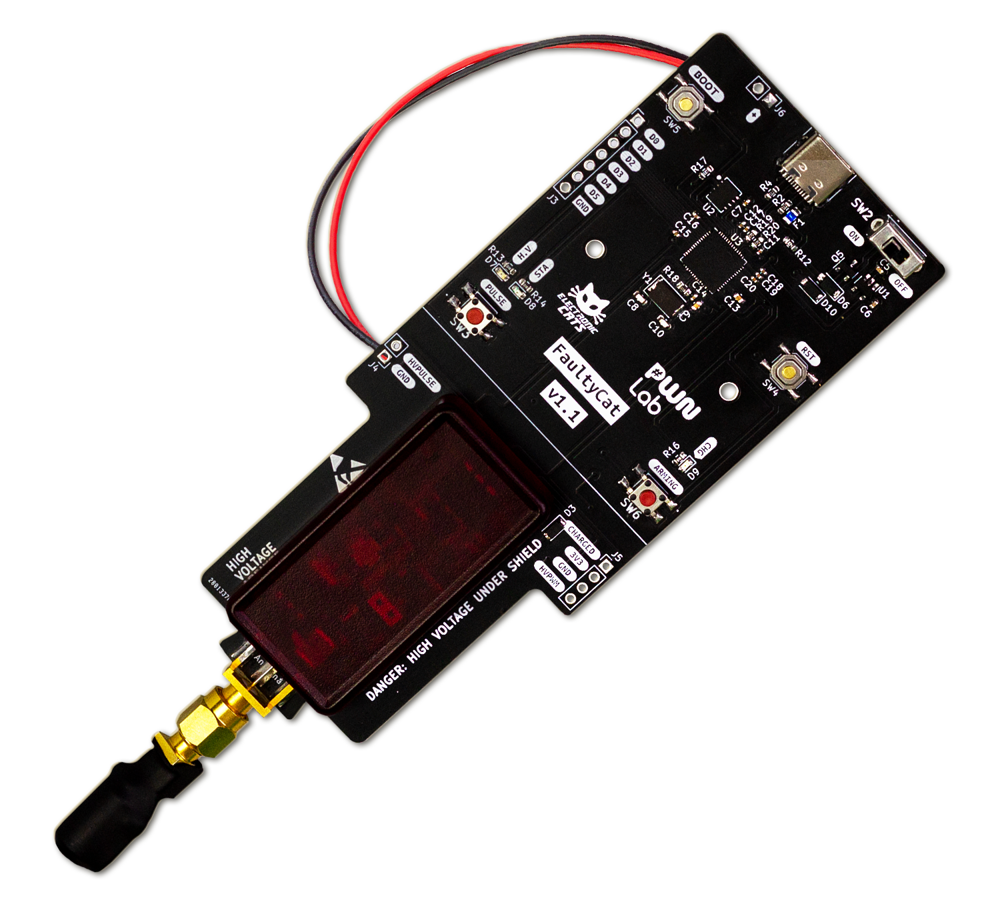 <small>Source: [ElectronicCats](https://github.com/ElectronicCats/faultycat)</small> | |
| **FaultyCat v2.1** | 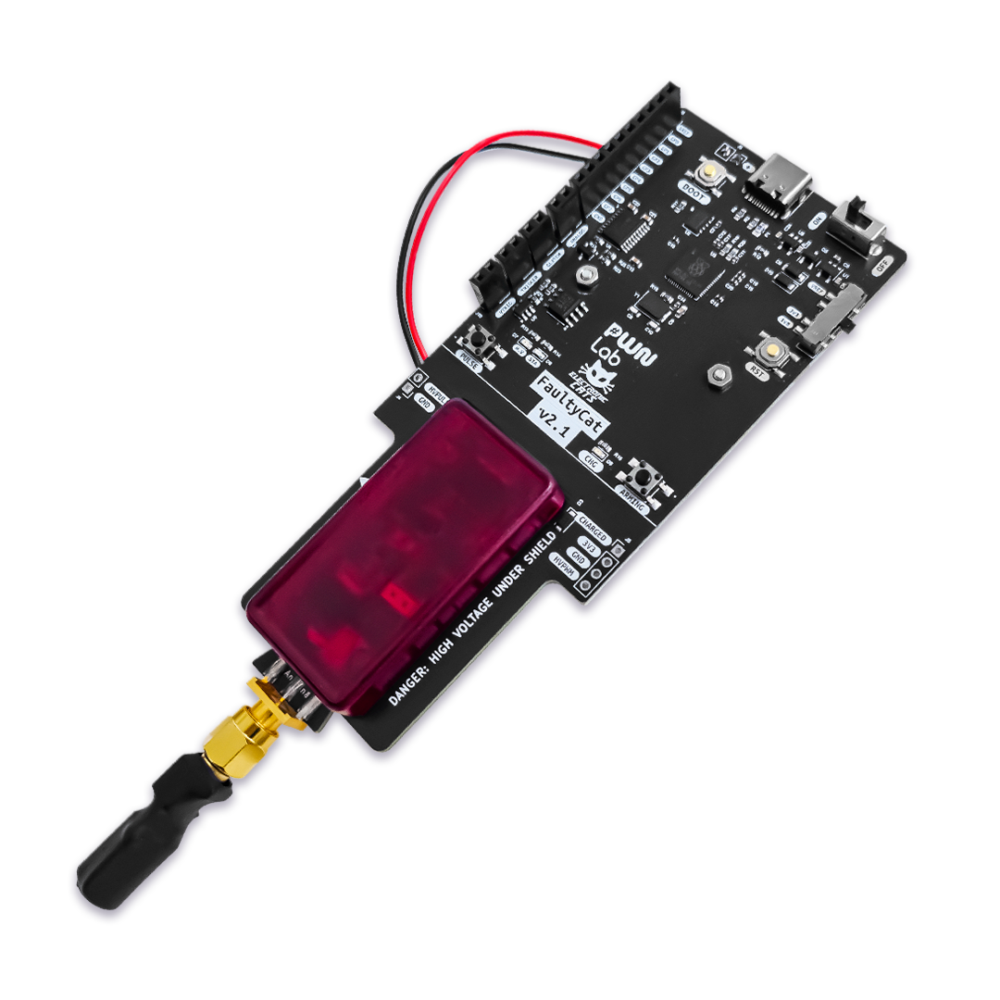 <small>Source: [ElectronicCats](https://github.com/ElectronicCats/faultycat)</small> | |
| **FaultyCat v2.1 (Clone)** | 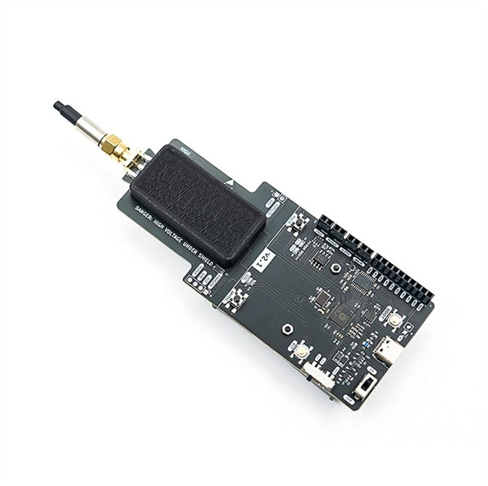 <small>Source: unknown</small> | Chinese knockoff |

## Ledger Donjon - Silicon Toaster

Silicon Toaster is an open-source electromagnetic fault-injection (EMFI) device developed by Ledger Donjon for hardware security research.

**Project:** [Ledger-Donjon/silicon-toaster](https://github.com/Ledger-Donjon/silicon-toaster)  
**Ledger Donjon blog post:** [A Compact Electromagnetic Fault Injection Setup](https://www.ledger.com/blog/compact-em)

| Revision / Model | Image & Photo Credit | Notes & Identification |
| :--- | :---: | :--- |
| **Silicon Toaster v0.1** | 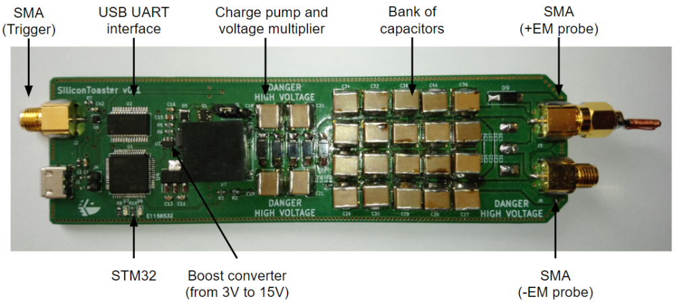 <small>Source: [Ledger Donjon - Compact EMFI Setup](https://www.ledger.com/blog/compact-em)</small> | |
| **Silicon Toaster v0.2** | 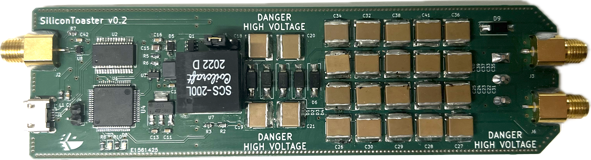 <small>Source: [Ledger Donjon Tools Suite](https://donjon.ledger.com/tools-suite/)</small> | |

  

